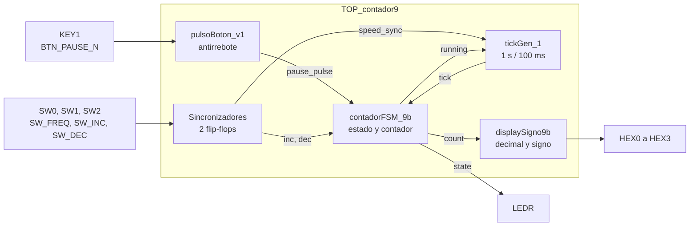
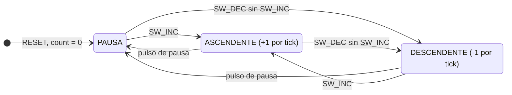

# Contador bidireccional de 9 bits con signo en FPGA (DE10-Lite)

Contador ascendente-descendente de 9 bits con signo, descrito en Verilog e implementado en la tarjeta **Terasic DE10-Lite** (FPGA Intel/Altera MAX 10, `10M50DAF484C7G`). Recorre el intervalo completo de complemento a dos, de **−256 a 255**, y muestra el valor en decimal en los displays de siete segmentos, con el signo negativo en `HEX3`.

Proyecto de la materia de Sistemas Embebidos, Universidad de las Américas Puebla (UDLAP).

## Características

- Registro con signo de 9 bits y conteo modular: `255 + 1 → −256` y `−256 − 1 → 255`.
- Máquina de estados de tres estados: **pausa**, **ascendente** y **descendente**.
- Dos velocidades de actualización seleccionables: **1 s** o **100 ms**, generadas con un pulso de habilitación (`tick`) a partir del reloj de 50 MHz. No se crean relojes nuevos.
- Botón de pausa con sincronizador de dos flip-flops, filtro antirrebote de 10 ms y pulso de un ciclo.
- Interruptores de velocidad y dirección con sincronizadores de dos flip-flops.
- Visualización en decimal: unidades en `HEX0`, decenas en `HEX1`, centenas en `HEX2` y guion en `HEX3` si el número es negativo.
- LEDs indicadores de estado, velocidad y signo.

## Diagrama de bloques

Todos los módulos usan el reloj de 50 MHz y el reinicio, que no se dibujaron para simplificar el diagrama.



## Diagrama de estados



## Estructura del repositorio

```
.
├── rtl/                      Código fuente en Verilog
│   ├── TOP_contador9.v       Módulo superior (conexión con la tarjeta)
│   ├── contadorFSM_9b.v      Máquina de estados y contador con signo
│   ├── tickGen_1.v           Generador del pulso de habilitación (1 s / 100 ms)
│   ├── pulsoBoton_v1.v       Sincronizador, antirrebote y pulso del botón
│   ├── displaySigno9b.v      Conversión a decimal y control de los displays
│   └── decod7Seg_dec.v       Decodificador de dígito a siete segmentos
├── sim/
│   └── tb_contadorFSM_9b.v   Testbench de la FSM con ticks abreviados
└── quartus/
    ├── contador_9bits.qpf    Proyecto de Quartus Prime
    └── contador_9bits.qsf    Dispositivo y asignación de pines
```

## Módulos

| Módulo | Función |
| --- | --- |
| `TOP_contador9` | Entidad principal. Sincroniza los interruptores, conecta los módulos y maneja los LEDs. |
| `contadorFSM_9b` | Unidad de control (estados) y ruta de datos (registro `count` con signo). |
| `tickGen_1` | Cuenta 50 000 000 ciclos (1 s) o 5 000 000 ciclos (100 ms) y genera un pulso de un ciclo. Se mantiene en cero durante la pausa. |
| `pulsoBoton_v1` | Botón activo en bajo: sincronización, antirrebote de 10 ms y pulso de un ciclo por pulsación. |
| `displaySigno9b` | Obtiene la magnitud, separa centenas, decenas y unidades, y muestra el signo en `HEX3`. |
| `decod7Seg_dec` | Convierte un dígito de 0 a 9 al patrón de siete segmentos (activo en bajo). |

## Controles y pines

| Señal | Elemento de la tarjeta | Pin | Función |
| --- | --- | --- | --- |
| `CLOCK_50` | Reloj de 50 MHz | `P11` | Reloj del sistema |
| `BTN_RESET_N` | `KEY0` | `B8` | Reinicio: `count = 0` y estado de pausa (activo en bajo) |
| `BTN_PAUSE_N` | `KEY1` | `A7` | Pausa (activo en bajo) |
| `SW_FREQ` | `SW0` | `C10` | `0`: 1 s, `1`: 100 ms |
| `SW_INC` | `SW1` | `C11` | Conteo ascendente |
| `SW_DEC` | `SW2` | `D12` | Conteo descendente |

Los pines de `HEX0` a `HEX3` y de `LEDR` están en `quartus/contador_9bits.qsf`.

**LEDs:** `LEDR[0]` pausa, `LEDR[1]` ascendente, `LEDR[2]` descendente, `LEDR[3]` velocidad de 100 ms, `LEDR[9]` número negativo.

**Prioridades:** reinicio > pausa > ascendente > descendente. Como `SW_INC` y `SW_DEC` se leen como niveles, la pausa se mantiene solo si ambos interruptores están apagados; con alguno activo, la FSM vuelve a contar un ciclo después de presionar `KEY1`.

## Cómo compilar y programar

Requiere **Intel Quartus Prime Lite 21.1** (o compatible) y un cable USB Blaster.

1. Abrir `quartus/contador_9bits.qpf`.
2. Compilar con *Processing → Start Compilation*. La entidad principal es `TOP_contador9`.
3. Conectar la DE10-Lite y programarla con *Tools → Programmer*, usando el archivo `.sof` generado en `quartus/output_files/`.

Uso de recursos reportado por Quartus: 381 elementos lógicos, 67 registros y 44 pines. No se usan memorias, multiplicadores ni PLL.

## Simulación

El testbench `sim/tb_contadorFSM_9b.v` simula únicamente `contadorFSM_9b`, con un reloj de 50 MHz y ticks de un ciclo aplicados directamente, para evitar esperar los 50 000 000 ciclos de un tick de 1 s. Compara el valor y el estado después de cada evento e imprime `PASS` o `FAIL`. Dura unos 27.9 µs de simulación.

Casos verificados:

| Valor actual | Evento | Valor esperado | Estado esperado |
| --- | --- | --- | --- |
| 0 | RESET | 0 | PAUSA |
| 0 | `SW_INC` y después tick | 1 | ASCENDENTE |
| 58 | tick | 59 | ASCENDENTE |
| 255 | tick | −256 | ASCENDENTE |
| 0 | `SW_DEC` y después tick | −1 | DESCENDENTE |
| −58 | tick | −59 | DESCENDENTE |
| −256 | tick | 255 | DESCENDENTE |
| 45 | PAUSA y varios ticks | 45 | PAUSA |
| −123 | RESET | 0 | PAUSA |

**Active-HDL:** crear un diseño, agregar `rtl/contadorFSM_9b.v` y `sim/tb_contadorFSM_9b.v`, compilar, inicializar la simulación con `tb_contadorFSM_9b` como módulo superior, agregar las señales a la ventana de ondas y ejecutar `run 30 us`. Al final debe aparecer `TODAS LAS PRUEBAS PASARON` en la consola.

**Icarus Verilog (opcional):**

```bash
iverilog -g2005 -o sim.out rtl/contadorFSM_9b.v sim/tb_contadorFSM_9b.v
vvp sim.out < /dev/null
```

## Video de pruebas

Las pruebas sobre la tarjeta se pueden ver en la siguiente carpeta pública de OneDrive: [Práctica 3](https://winliveudlap-my.sharepoint.com/:f:/g/personal/rodrigo_carreterosa_udlap_mx/IgDwbXoNn_ISRLp1bU0vUFY5AbVkqDhF9Ye8vbMiTS0BIL8?e=hh9H49)

## Autores

- Rodrigo Daniel Carretero Santamaría
- Victor Hugo De La Calleja Mojica

Universidad de las Américas Puebla (UDLAP).
